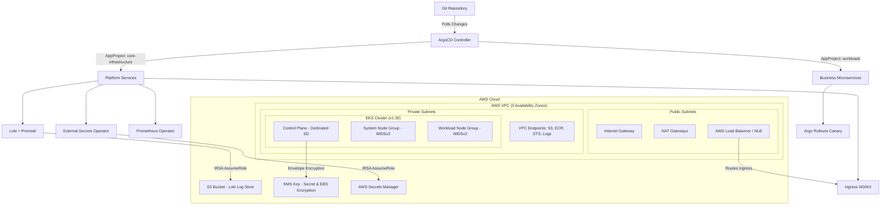

# Production-Grade GitOps Platform on AWS EKS

[](https://www.terraform.io/)
[](https://aws.amazon.com/eks/)
[](https://argoproj.github.io/cd/)
[](https://helm.sh/)
[](https://grafana.com/)
[](https://github.com/aquasecurity/trivy)

This repository implements an enterprise-ready, production-grade **GitOps Infrastructure and Observability Platform on AWS EKS**. It adheres to zero-trust security standards, multi-tenant ArgoCD project governance, envelope encryption, automated secrets synchronization, progressive delivery canary rollouts, and comprehensive DevSecOps validation.

---

## 🏗️ Architecture Overview

The platform cleanly decouples core cloud infrastructure (managed by **Terraform**) from Kubernetes runtime applications and observability stacks (managed by **ArgoCD**).



### Enterprise Feature Highlights
* **Private Networking & Cost Optimization**: AWS VPC Endpoints provisioned for S3 (Gateway), ECR API, ECR Docker registry, STS, and CloudWatch Logs to eliminate data traversal costs through NAT Gateways.
* **EKS Security Hardening**: Dedicated, least-privilege Security Groups for the control plane and worker nodes, **AWS KMS** envelope encryption for Kubernetes secrets and EBS storage, enforced **IMDSv2**, and node session access via **AWS SSM**.
* **Zero-Trust Network Policies**: Hardened Kubernetes `NetworkPolicy` resources enforcing default-deny ingress/egress boundaries, DNS isolation, and controlled ingress controller routing.
* **Pod Security Standards (PSA)**: Automated namespace admission control labels enforcing `restricted` security profiles for application workloads and `baseline` for platform services.
* **External Secrets Management**: Fully automated synchronization of credentials from **AWS Secrets Manager** via **External Secrets Operator (ESO)** and IRSA tokens, eliminating plaintext secrets in Git.
* **ArgoCD Multi-Tenancy & RBAC**: Custom `AppProject` definitions separating cluster-scoped `core-infrastructure` from isolated, namespace-restricted `workloads`.
* **Progressive Delivery**: Built-in **Argo Rollouts** canary engine featuring automated Prometheus analysis templates (`AnalysisTemplate`) with instantaneous error-budget rollbacks.
* **Full Observability Matrix**: Prometheus Operator, custom `PrometheusRule` alerting definitions, automated Loki log aggregation in S3, and pre-packaged Grafana dashboard ConfigMaps loaded dynamically via sidecar.
* **Developer Experience**: Automated `Makefile` task runner, `.pre-commit-config.yaml` git hooks, and comprehensive DevSecOps CI matrix with **Trivy**, **Gitleaks**, and **yamllint**.

---

## 📁 Repository Structure

```
.
├── .editorconfig                          # Indentation and formatting standards
├── .gitignore                             # Ignored files, state caches, and secrets
├── .pre-commit-config.yaml                # Pre-commit git hooks
├── Makefile                               # Developer automation task runner
├── README.md                              # Platform documentation & guides
├── .github/workflows/
│   └── ci.yml                             # Consolidated CI (Trivy, Gitleaks, Helm, Terraform)
├── docs/runbooks/                         # Operational Runbooks & Playbooks
│   ├── argocd-troubleshooting.md          # Diagnosing OutOfSync & sync timeouts
│   ├── disaster-recovery.md               # Complete cluster reconstruction guide
│   └── secrets-management.md              # AWS Secrets Manager & ESO workflows
├── terraform/                             # Cloud Infrastructure as Code
│   ├── providers.tf                       # Provider configurations & version constraints
│   ├── variables.tf                       # Input variables with safety validation
│   ├── outputs.tf                         # VPC, cluster, KMS, and IRSA role outputs
│   ├── vpc.tf                             # VPC, subnets, route tables, and VPC Endpoints
│   ├── eks.tf                             # EKS cluster, hardened SGs, KMS policy, EBS encryption
│   ├── irsa.tf                            # IAM Roles for EBS CSI, Loki, Autoscaler, & ESO
│   ├── state-storage.tf                   # S3 state bucket & DynamoDB lock table
│   ├── vpc-flow-logs.tf                   # CloudWatch VPC Flow Logs
│   ├── budgets.tf                         # AWS Budget cost tracking and alert thresholds
│   └── terraform.tfvars.example           # Production variable template
└── gitops/                                # ArgoCD GitOps Configurations
    ├── bootstrap/                         # Bootstrap configurations
    │   ├── appprojects.yaml               # Multi-tenant AppProjects (infrastructure & workloads)
    │   ├── argocd-install-values.yaml     # Production HA values for ArgoCD Helm chart
    │   └── root-application.yaml          # App-of-Apps root application
    ├── infrastructure/                    # Platform Helm Umbrella Chart
    │   ├── Chart.yaml                     # Umbrella chart metadata
    │   ├── values.yaml                    # Global parameter overrides and service toggles
    │   └── templates/                     # Platform service declarations
    │       ├── argo-rollouts.yaml         # Argo Rollouts progressive delivery controller
    │       ├── cert-manager.yaml          # Cert-Manager TLS certificate manager
    │       ├── cluster-autoscaler.yaml    # AWS Cluster Autoscaler with IRSA
    │       ├── cluster-issuer.yaml        # Let's Encrypt production ClusterIssuer
    │       ├── external-dns.yaml          # Route53 External-DNS controller
    │       ├── external-secrets.yaml      # External Secrets Operator & ClusterSecretStore
    │       ├── grafana-dashboards.yaml    # Curated Grafana dashboard ConfigMaps
    │       ├── ingress-nginx.yaml         # High-availability NGINX Ingress Controller
    │       ├── kube-prometheus.yaml       # Kube-Prometheus stack (Prometheus, Grafana, Alertmanager)
    │       ├── loki-stack.yaml            # Loki log storage (S3 backend) & Promtail DaemonSet
    │       ├── metrics-server.yaml        # Metrics Server for pod autoscaling (HPA)
    │       ├── network-policies.yaml      # Zero-trust namespace isolation policies
    │       ├── pod-security-standards.yaml # PSA namespace admission enforcement
    │       ├── prometheus-rules.yaml      # Actionable Prometheus alerting rules
    │       ├── sample-app.yaml            # ArgoCD Application deploying the reference workload
    │       └── storage-classes.yaml       # GP3 encrypted StorageClasses with volume expansion
    └── applications/
        └── sample-workload/               # Golden-path progressive delivery reference app
            ├── analysis-template.yaml     # Prometheus error-rate analysis
            ├── ingress.yaml               # Ingress routing
            ├── kustomization.yaml         # Kustomize manifest
            ├── rollout.yaml               # Canary Rollout definition (20% -> 50% -> 80% -> 100%)
            └── service.yaml               # Stable & Canary cluster services
```

---

## 🚀 Step-by-Step Deployment Guide

### Prerequisites
- [AWS CLI v2](https://aws.amazon.com/cli/) (authenticated with admin permissions)
- [Terraform](https://developer.hashicorp.com/terraform/downloads) (>= 1.5.0)
- [kubectl](https://kubernetes.io/docs/tasks/tools/)
- [Helm](https://helm.sh/docs/intro/install/) (>= 3.14.0)

---

### Step 1: Provision Cloud Infrastructure with Terraform
```bash
cd terraform
terraform init
terraform plan -var-file=terraform.tfvars.example -out=tfplan
terraform apply tfplan
```
*Outputs cluster name, KMS key ARN, VPC Endpoints, and IRSA role ARNs required for the GitOps layer.*

---

### Step 2: Configure Local Kubectl
```bash
aws eks update-kubeconfig --region us-west-2 --name gitops-eks-prod
kubectl get nodes -o wide
```

---

### Step 3: Install ArgoCD HA Engine
```bash
helm repo add argo https://argoproj.github.io/argo-helm
helm repo update

kubectl create namespace argocd
helm install argocd argo/argo-cd \
  --namespace argocd \
  -f ../gitops/bootstrap/argocd-install-values.yaml
```

---

### Step 4: Bootstrap Multi-Tenancy & GitOps Root Application
1. Update `gitops/bootstrap/root-application.yaml` and `gitops/infrastructure/values.yaml` with your repository URL and Terraform outputs (IRSA ARNs and S3 bucket names).
2. Apply the multi-tenant `AppProject` boundaries:
   ```bash
   kubectl apply -f ../gitops/bootstrap/appprojects.yaml
   ```
3. Deploy the root application:
   ```bash
   kubectl apply -f ../gitops/bootstrap/root-application.yaml
   ```

*ArgoCD will automatically discover all child platform services and the reference canary workload, synchronizing them to the cluster in dependency order.*

---

## 🛠️ Developer Tooling & Verification

A `Makefile` is included to streamline local development and validation:

| Command | Description |
| :--- | :--- |
| `make fmt` | Recursively format all Terraform code |
| `make lint` | Run Terraform format verification and Helm chart linting |
| `make tf-init` | Initialize Terraform providers |
| `make tf-validate` | Validate syntax and references across Terraform code |
| `make tf-plan` | Generate an execution plan against `terraform.tfvars.example` |
| `make test` | Run full pre-flight CI validation locally |

---

## 📖 Operational Runbooks
Detailed incident response and maintenance runbooks are provided:
* [ArgoCD Troubleshooting Runbook](docs/runbooks/argocd-troubleshooting.md)
* [Secrets Management with External Secrets Operator](docs/runbooks/secrets-management.md)
* [Disaster Recovery & Cluster Reconstruction Guide](docs/runbooks/disaster-recovery.md)
