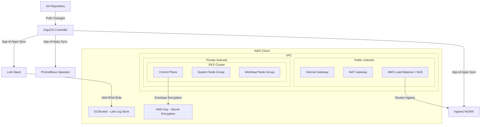

# Production-Grade GitOps Platform on AWS EKS

[](https://www.terraform.io/)
[](https://aws.amazon.com/eks/)
[](https://argoproj.github.io/cd/)
[](https://helm.sh/)
[](https://grafana.com/)

This repository implements a production-grade, enterprise-ready **GitOps Infrastructure and Observability Platform**. It provides a fully automated workflow to provision cloud resources on AWS and deploy a Kubernetes monitoring and logging stack using declarative GitOps patterns.

---

## 🏗️ Architecture Overview

The platform uses a layered architecture separating core cloud infrastructure (managed by **Terraform**) from Kubernetes applications and configurations (managed by **ArgoCD**).



### Core Features
* **IaC Foundations**: Highly available VPC spanning 3 Availability Zones, NAT Gateways, and private subnets hosting EKS nodes.
* **EKS Hardening**: Envelope encryption of K8s Secrets using **AWS KMS**, private control plane access enabled, and worker nodes isolated in private subnets.
* **Identity Integration (IRSA)**: Integrates AWS IAM with Kubernetes Service Accounts via OIDC, eliminating long-lived credentials for the EBS CSI Driver and Loki S3 access.
* **GitOps App-of-Apps Pattern**: Uses a root ArgoCD application to manage lifecycle operations (pruning, self-healing, and syncing) for cluster-wide workloads.
* **Observability (PLG Stack)**: Automated deployment of Prometheus (metrics metrics), Loki (centralized logs aggregated in S3), and Grafana dashboards.

---

## 📁 Repository Structure

```
.
├── terraform/                         # Terraform Infrastructure Code
│   ├── providers.tf                   # Version constraints & provider declarations
│   ├── variables.tf                   # Configurable input variables
│   ├── outputs.tf                     # Exported cluster/network outputs
│   ├── vpc.tf                         # VPC, subnets, gateways, and routing
│   ├── eks.tf                         # EKS Cluster, Node Groups, KMS, OIDC
│   └── irsa.tf                        # IAM Roles for Service Accounts (EBS & Loki S3)
└── gitops/                            # ArgoCD GitOps Configurations
    ├── bootstrap/                     # Initial bootstrapping resources
    │   ├── argocd-install-values.yaml # Helm configuration overrides for ArgoCD HA
    │   └── root-application.yaml      # ArgoCD App-of-Apps root declaration
    └── infrastructure/                # Platform infrastructure apps
        ├── Chart.yaml                 # Umbrella Helm chart
        ├── values.yaml                # Global config values (domains, roles, buckets)
        └── templates/                 # ArgoCD Application declarations
            ├── ingress-nginx.yaml     # NGINX Ingress Controller App
            ├── kube-prometheus.yaml   # Prometheus Operator & Grafana App
            └── loki-stack.yaml        # Loki & Promtail Logging App
```

---

## 🚀 Step-by-Step Deployment Guide

### Prerequisites
Before you begin, ensure you have the following installed and configured locally:
- [AWS CLI](https://aws.amazon.com/cli/) (authenticated with Admin credentials)
- [Terraform](https://developer.hashicorp.com/terraform/downloads) (>= 1.5.0)
- [kubectl](https://kubernetes.io/docs/tasks/tools/)
- [Helm](https://helm.sh/docs/intro/install/)

### Step 1: Provision Infrastructure with Terraform
Navigate to the terraform directory, initialize providers, and apply configs:
```bash
cd terraform
terraform init
terraform plan
terraform apply -auto-approve
```
*This step takes ~15 minutes. It outputs the cluster name, S3 bucket names, and IAM Roles needed in the next steps.*

### Step 2: Configure Local Kubectl
Connect your local terminal to the newly provisioned EKS cluster:
```bash
aws eks update-kubeconfig --region us-west-2 --name gitops-eks-prod
```
Verify the cluster nodes are healthy:
```bash
kubectl get nodes
```

### Step 3: Install & Configure ArgoCD
Add the ArgoCD Helm repository, configure values, and install it to the cluster:
```bash
# Add repo
helm repo add argo https://argoproj.github.io/argo-helm
helm repo update

# Install ArgoCD via Helm
kubectl create namespace argocd
helm install argocd argo/argo-cd \
  --namespace argocd \
  -f ../gitops/bootstrap/argocd-install-values.yaml
```

### Step 4: Bootstrap the GitOps Pipeline
1. Create a Git repository and push this codebase to your GitHub/GitLab account.
2. Open [gitops/bootstrap/root-application.yaml](gitops/bootstrap/root-application.yaml) and update the `repoURL` to point to your new repo.
3. Open [gitops/infrastructure/values.yaml](gitops/infrastructure/values.yaml) and update the `global.repoURL`, `lokiStack.aws.s3Bucket`, and `lokiStack.aws.roleArn` using the outputs generated by Terraform in **Step 1**.
4. Commit and push these modifications to your repository.
5. Deploy the root application to EKS:
```bash
kubectl apply -f ../gitops/bootstrap/root-application.yaml
```

*ArgoCD will immediately scan the Git repository, discover the child apps (Ingress NGINX, Prometheus/Grafana, Loki), and deploy them in the correct dependency order.*

---

## 📊 Verification & Observability

### Accessing the ArgoCD Dashboard
Retrieve the auto-generated admin password and port-forward to the server service:
```bash
# Get the admin password
kubectl -n argocd get secret argocd-initial-admin-secret -o jsonpath="{.data.password}" | base64 --decode; echo

# Port-forward to local
kubectl port-forward svc/argocd-server -n argocd 8080:443
```
Visit `https://localhost:8080` in your browser and log in with username `admin` and the password retrieved above.

### Exposing and Accessing Grafana
Port-forward to the Grafana service to access dashboard metrics and logs:
```bash
kubectl port-forward svc/kube-prometheus-stack-grafana -n monitoring 3000:80
```
1. Open `http://localhost:3000` in your web browser. (Credentials: User: `admin` / Password: `admin` - as configured in Helm values).
2. Go to **Explore** in the side menu.
3. Choose **Loki** from the datasource dropdown to query aggregated log streams shipped by Promtail.
4. Go to **Dashboards** to view pre-built dashboards for Kubernetes node capacity, pod memory utilization, and network traffic.

---

## 🔒 Enterprise Production Hardening Guidelines
To transition this structure to an enterprise-wide setting, consider implementing:
* **State Management**: Migrate Terraform's local state file to an S3 backend configured with DynamoDB table state locking.
* **Private EKS Networking**: Disable EKS public endpoint access (`endpoint_public_access = false`) and access the control plane via AWS Client VPN or Transit Gateway.
* **SSO Authentication**: Configure Dex inside ArgoCD to integrate with Okta, Active Directory, or GitHub teams for Role-Based Access Control (RBAC).
* **Automated DNS & Certificates**: Install `external-dns` to automatically create Route53 records and `cert-manager` to provision Let's Encrypt certificates automatically for ingress resources.
