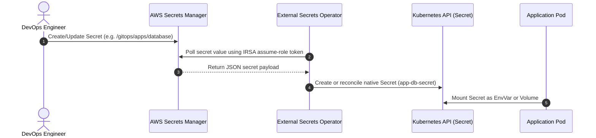

# Secrets Management with External Secrets Operator & AWS Secrets Manager

## Overview
This platform strictly adheres to the GitOps principle: **Never commit plaintext secrets to Git**. Secrets are stored in AWS Secrets Manager and synchronized into native Kubernetes Secrets via the **External Secrets Operator (ESO)** and IAM Roles for Service Accounts (IRSA).

---

## 1. How External Secrets Synchronization Works



---

## 2. Provisioning a Secret in AWS Secrets Manager

Use the AWS CLI to store secrets within the authorized `/gitops/*` path prefix:

```bash
aws secretsmanager create-secret \
  --name "/gitops/apps/database" \
  --description "Database credentials for demo API" \
  --secret-string '{"DB_USER":"postgres","DB_PASSWORD":"supersecretpassword123!"}' \
  --region us-west-2
```

---

## 3. Declaring an `ExternalSecret` Manifest

Create an `ExternalSecret` manifest in your workload directory:

```yaml
apiVersion: external-secrets.io/v1beta1
kind: ExternalSecret
metadata:
  name: database-credentials
  namespace: apps
spec:
  refreshInterval: 1h             # How often ESO reconciles with AWS
  secretStoreRef:
    name: aws-secrets-manager     # References ClusterSecretStore
    kind: ClusterSecretStore
  target:
    name: database-credentials    # The native K8s Secret to generate
    creationPolicy: Owner
  data:
    - secretKey: DB_USER
      remoteRef:
        key: /gitops/apps/database
        property: DB_USER
    - secretKey: DB_PASSWORD
      remoteRef:
        key: /gitops/apps/database
        property: DB_PASSWORD
```

---

## 4. Troubleshooting ESO Synchronization Failures

### Check ExternalSecret Status
```bash
kubectl describe externalsecret database-credentials -n apps
```

### Common Errors:
1. **`AccessDeniedException`**:
   - Verify that the IAM Role ARN specified in `gitops/infrastructure/values.yaml` has the policy attached from `terraform/irsa.tf`.
   - Verify the secret name starts with `/gitops/` matching the resource ARN constraint in IAM.
2. **`ResourceNotFoundException`**:
   - Verify the secret exists in the specified AWS region (`us-west-2`).
3. **ClusterSecretStore Not Ready**:
   ```bash
   kubectl get clustersecretstore aws-secrets-manager
   ```
